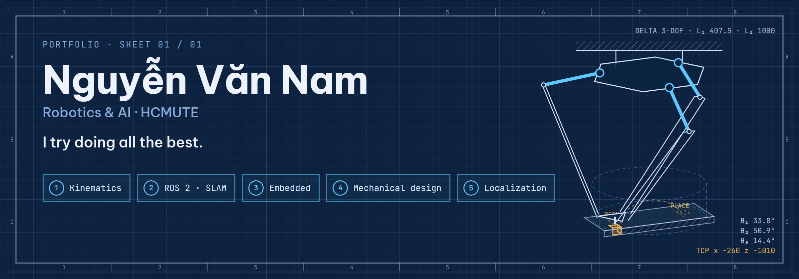

<picture>
  <source media="(max-width: 600px)" srcset="banner-mobile.png">
  <source media="(prefers-reduced-motion: reduce)" srcset="banner.png">
  
</picture>

[LinkedIn](https://www.linkedin.com/in/namngguyen205) · [X](https://x.com/JohnnNg205) · [Email](mailto:ngvnam2005@gmail.com)

Fourth-year **Robotics and Artificial Intelligence** student at **Ho Chi Minh City University of Technology and Engineering (HCMUTE)**, Faculty of Mechanical Engineering. Born in 2005, based in Ho Chi Minh City.

Currently an **Embedded intern at Bosch Global Software Technologies Vietnam (BGSV)**. On the side, I'm taking my omni-directional robot from Gazebo simulation to real hardware.

I work across the whole robot: mechanical design and kinematics, STM32 firmware, and ROS 2 navigation on top. Outside of work, I'm a Porsche and BMW enthusiast.

### Selected work

| Project | What I worked on |
| :--- | :--- |
| [Delta Robot Design](https://github.com/JohnNguyen205/Delta-Robot-Design) | Ceiling-mounted 3-DOF Delta robot for 2 kg pick-and-place: closed-form kinematics in MATLAB, SolidWorks CAD and FEA with a minimum safety factor of 7.1. |
| [Robot Omni Navigation](https://github.com/JohnNguyen205/Robot-Omni-Navigation) | Omni-directional delivery robot in a simulated hospital, built on ROS 2 and Nav2, with a genetic algorithm that orders multi-room routes. |
| [SLAM Navigation Robot](https://github.com/JohnNguyen205/SLAM-Navigation-Robot) | STM32F407 firmware for a mobile robot base (encoders, IMU, motor PID, UART bridge) that maps, localizes and navigates on ROS 2 Jazzy. |
| [IRB 1300 in Unity](https://github.com/JohnNguyen205/Simulation-robot-IRB1300-on-Unity) | ABB IRB 1300 six-axis arm simulated in Unity, with forward and inverse kinematics checked against the measured pose. |
| UWB Localization | University research on Ultra-Wideband indoor positioning for mobile robots. |

### Toolkit

  &nbsp;
  &nbsp;
  &nbsp;
  &nbsp;
  &nbsp;
  &nbsp;
  &nbsp;
  &nbsp;
  &nbsp;
  

**Robotics:** ROS 2 (Nav2, SLAM, Gazebo, RViz), robot kinematics, ABB robot programming, PLC  
**Embedded & electronics:** C/C++, STM32, Arduino, circuit design, PCB layout, Proteus  
**Design & simulation:** SolidWorks (CAD, FEA), MATLAB/Simulink, Unity, Python

### Recognition

- ROBOGLADIATORS robotics competition, qualifying round (2025)
- Encouragement Prize, school-level AI Olympiad (2025)
- Third Prize, provincial Physics excellent-student competition (2022)

[Get in touch](mailto:ngvnam2005@gmail.com) about robotics, embedded systems or automation.
